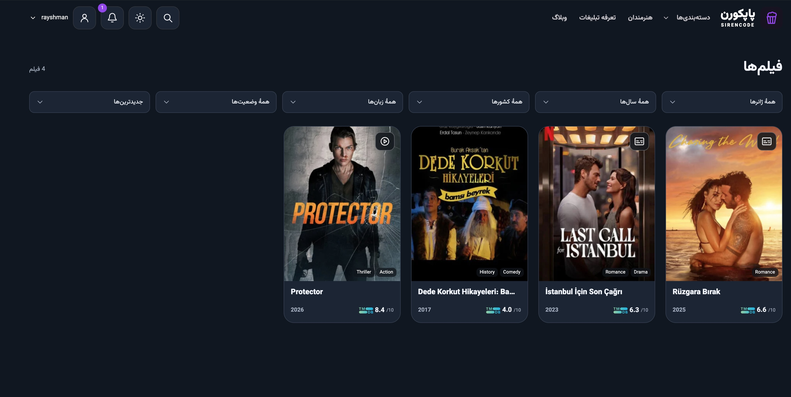
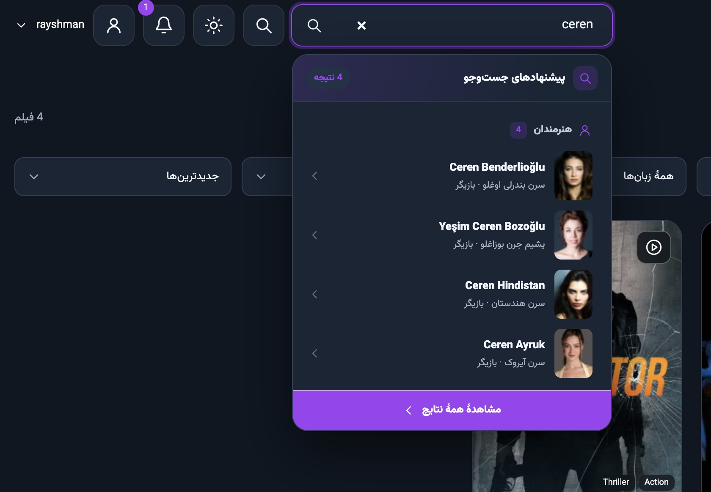

  

<h1 align="center">پاپکورن | Popcorn</h1>

قالب فارسی و راست‌به‌چپ وردپرس برای ساخت سایت فیلم و سریال

  <a href="https://github.com/SirenCode69/popcorn/releases/latest"><strong>دریافت آخرین نسخه</strong></a>
  · <a href="./docs/INSTALL-fa.md">راهنمای نصب</a>
  · <a href="https://github.com/SirenCode69/popcorn/issues">گزارش مشکل</a>
  · <a href="./LICENSE">مجوز</a>

---

## پاپکورن چه امکاناتی دارد؟

با پاپکورن می‌توانید برای فیلم‌ها، سریال‌ها و هنرمندان صفحه‌های اختصاصی بسازید. هستهٔ قالب اطلاعات و تصاویر آثار را از TMDb دریافت می‌کند و امکان مدیریت فصل‌ها، قسمت‌ها، کیفیت‌های دانلود و منابع پخش را در پیشخوان وردپرس فراهم می‌کند.

- **ظاهر و چیدمان** · طراحی واکنش‌گرا، حالت روشن و تاریک، فونت محلی وزیرمتن و رنگ اصلی قابل تنظیم
- **کشف آثار** · جست‌وجوی زنده، فیلترهای آرشیو، صفحهٔ هنرمندان، کالکشن‌ها و جدول هفتگی پخش سریال‌ها
- **پخش و دانلود** · مدیریت کیفیت، حجم و زبان لینک‌ها، پخش آنلاین با زیرنویس و امکان تعیین زمان اعتبار لینک‌ها
- **تعامل با مخاطب** · وبلاگ، دیدگاه‌ها، امتیازدهی، علاقه‌مندی‌ها و اطلاعیه‌های آثار
- **حساب و اشتراک** · ورود و ثبت‌نام، پنل کاربری و فروش پلن به کمک افزونه‌های اختیاری

## تصاویر محیط پاپکورن

  
  

[گالری کامل تصاویر سایت و پیشخوان](./docs/screenshots/README.md)

## شروع کار

1. فایل `popcorn-1.0.0.zip` را بگیرید. در پیشخوان وردپرس به «نمایش ← پوسته‌ها ← افزودن پوسته ← بارگذاری پوسته» بروید، ZIP را نصب کنید و قالب را فعال کنید. [دانلود ZIP قالب](https://github.com/SirenCode69/popcorn/releases/download/v1.0.0/popcorn-1.0.0.zip)
2. در اعلان «افزونه‌های همراه پاپکورن»، کنار «هستهٔ پاپکورن» روی «نصب از بستهٔ قالب» بزنید و پس از نصب، افزونه را فعال کنید. وردپرس فایل افزونه را از داخل قالب می‌خواند.
3. در منوی «پاپکورن»، رنگ و حالت نمایش را انتخاب کنید. برای دریافت اطلاعات فیلم، سریال و هنرمندان، کلید TMDb خود را در تب TMDb وارد کنید. بعد از نصب هسته، یک بار تنظیمات پیوندهای یکتا را ذخیره کنید.
4. برای راه‌اندازی ورود و ثبت‌نام، افزونهٔ «حساب کاربری پاپکورن» را نصب و روش ورود را تنظیم کنید. برای فروش پلن، بعد از راه‌اندازی حساب کاربری، افزونهٔ «اشتراک پاپکورن» را هم فعال کنید. [راهنمای کامل نصب و تنظیمات](./docs/INSTALL-fa.md)

## اجزای پاپکورن

<table align="center" dir="rtl">
  <thead>
    <tr>
      <th scope="col" align="right">نام</th>
      <th scope="col" align="right">نوع</th>
      <th scope="col" align="right">کاربرد</th>
    </tr>
  </thead>
  <tbody>
    <tr>
      <td align="right"><strong>پاپکورن</strong></td>
      <td align="right">قالب اصلی</td>
      <td align="right">صفحهٔ آثار و هنرمندان، بلاگ، آرشیو و جست‌وجو</td>
    </tr>
    <tr>
      <td align="right"><strong>هستهٔ پاپکورن</strong></td>
      <td align="right">افزونهٔ ضروری برای کاتالوگ</td>
      <td align="right">مدیریت آثار، دریافت اطلاعات از TMDb، پخش و دانلود</td>
    </tr>
    <tr>
      <td align="right"><strong>حساب کاربری پاپکورن</strong></td>
      <td align="right">افزونهٔ اختیاری</td>
      <td align="right">ورود، ثبت‌نام، پروفایل و علاقه‌مندی‌ها</td>
    </tr>
    <tr>
      <td align="right"><strong>اشتراک پاپکورن</strong></td>
      <td align="right">افزونهٔ اختیاری</td>
      <td align="right">فروش پلن و تعیین دسترسی به دانلود. به حساب کاربری نیاز دارد.</td>
    </tr>
    <tr>
      <td align="right"><strong>پاپکورن فرزند</strong></td>
      <td align="right">قالب اختیاری</td>
      <td align="right">محل افزودن CSS، PHP و فایل‌های نمایشی اختصاصی</td>
    </tr>
  </tbody>
</table>

در صفحهٔ انتشار، بستهٔ نصب جداگانهٔ هر افزونه و قالب فرزند هم در دسترس است. فایل `popcorn-release-1.0.0.zip` همهٔ بسته‌ها و راهنمای نصب را یک‌جا دارد. [بسته‌های نسخهٔ ۱.۰.۰](https://github.com/SirenCode69/popcorn/releases/tag/v1.0.0)

## نیازمندی‌ها

- وردپرس با PHP 8.0 یا بالاتر و پایگاه دادهٔ MySQL یا MariaDB سازگار با وردپرس
- اتصال خروجی HTTPS برای TMDb و سرویس‌های بیرونی
- HTTPS روی نشانی سایت برای حساب کاربری و پرداخت

## ساختار مخزن

فایل‌های قالب اصلی در ریشهٔ مخزن قرار دارند. فایل `style.css` مشخصات قالب را دارد، `template-parts/` بخش‌های نمایشی را نگه می‌دارد و `assets/` محل استایل‌ها، اسکریپت‌ها و فونت‌هاست. بسته‌های نصب افزونه‌ها در `plugins/` قرار دارند و سورس افزونه‌ها و قالب فرزند در `packages/` است.

## مجوز و گزارش مشکل

کد پاپکورن تحت **GPL نسخهٔ ۲ یا بالاتر** منتشر می‌شود. وزیرمتن و Swiper مجوزهای خودشان را دارند. [متن GPL](./LICENSE) · [مجوز وزیرمتن](./assets/fonts/OFL.txt) · [مجوز Swiper](./assets/vendor/swiper/LICENSE)

برای گزارش مشکل، نسخهٔ پاپکورن، وردپرس و PHP را همراه با مسیر صفحه و مراحل بازتولید بنویسید. [ثبت گزارش در GitHub](https://github.com/SirenCode69/popcorn/issues/new)

طراحی و توسعه توسط [SirenCode69](https://github.com/SirenCode69).

