# تصاویر محیط پاپکورن

[بازگشت به معرفی و راهنمای نصب پاپکورن](../../README.md)

## نمای سایت

### صفحهٔ اصلی

[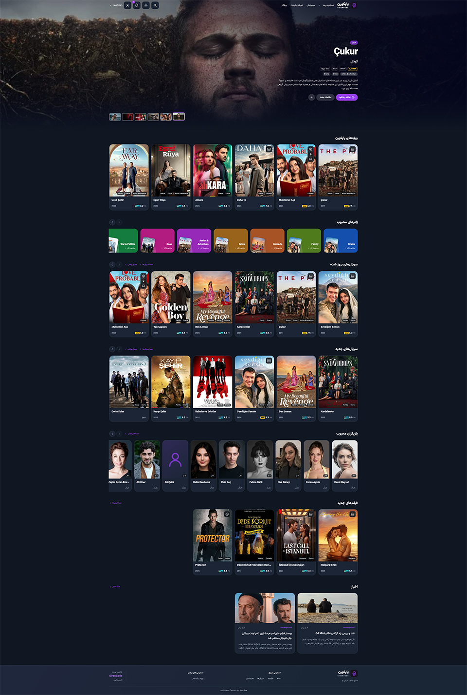](./homepage.jpg)

### آرشیو فیلم‌ها

[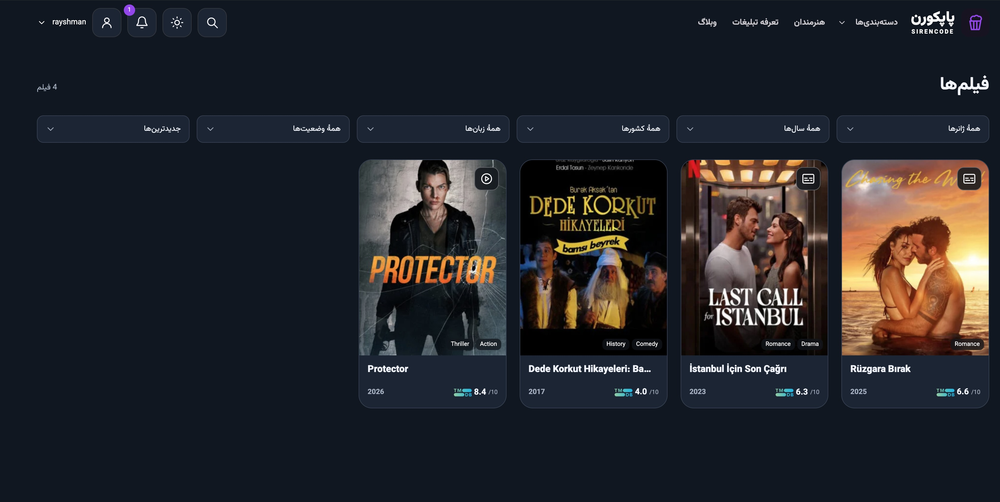](./movie-archive.jpg)

### صفحهٔ سریال

[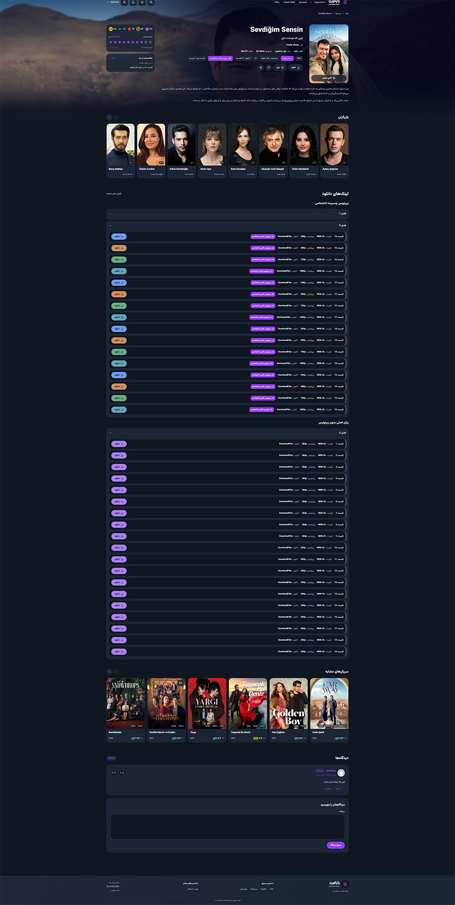](./series-page.jpg)

### جدول پخش هفتگی

[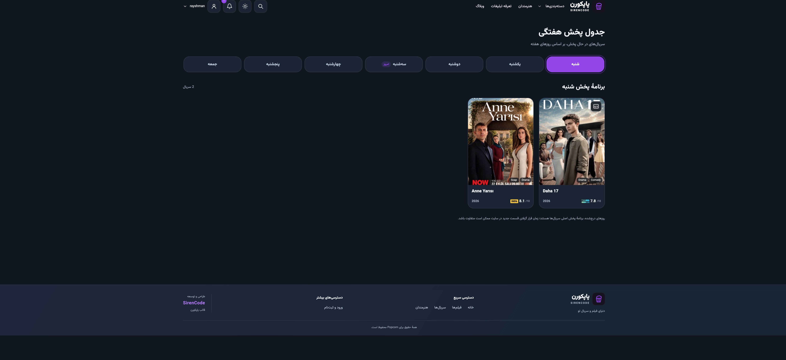](./weekly-schedule.jpg)

### آرشیو هنرمندان

### صفحهٔ هنرمند

### منوی دسته‌بندی‌ها

### جست‌وجوی زنده

[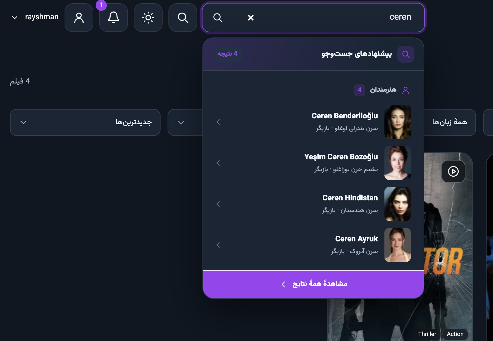](./live-search.jpg)

### اعلان‌ها در حالت روشن

[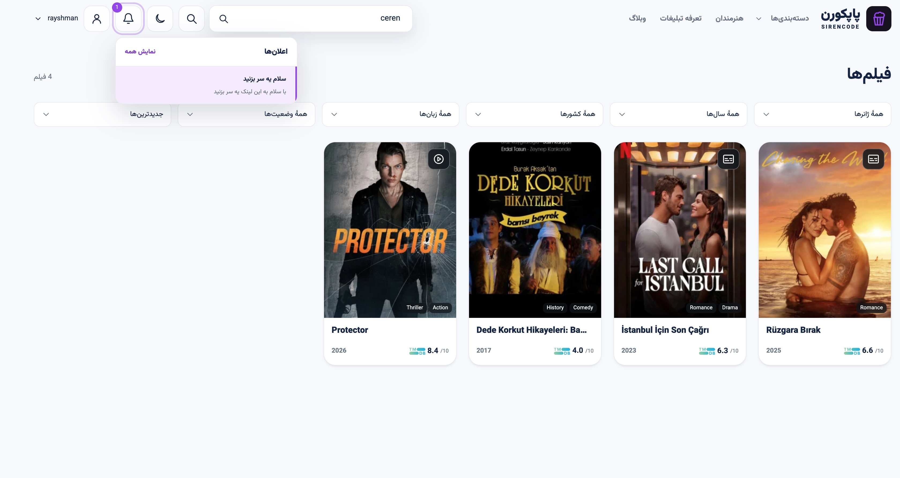](./notifications-light.jpg)

### نوشتهٔ وبلاگ

[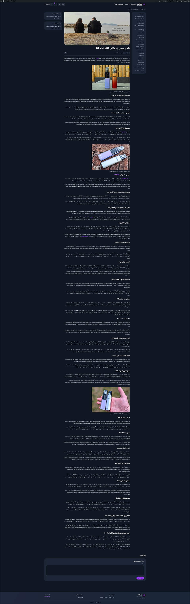](./blog-post.jpg)

## پیشخوان وردپرس

### تنظیمات عمومی پاپکورن

[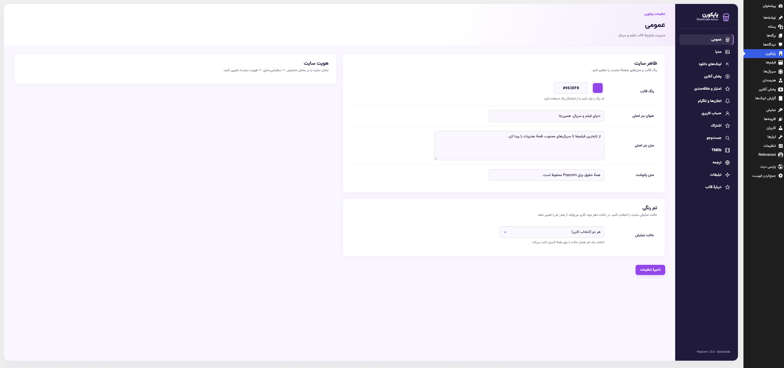](./admin-settings.jpg)

### ویرایش فیلم

[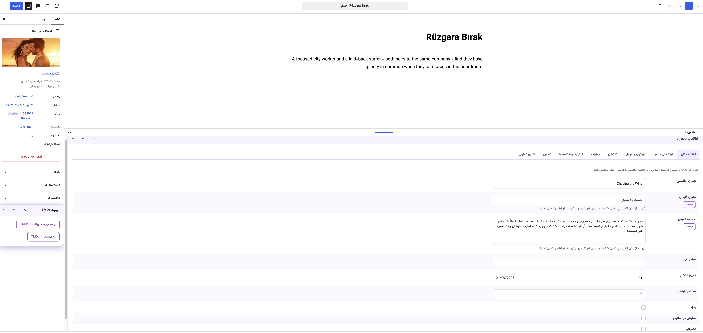](./admin-movie-editor.jpg)

### ویرایش سریال

[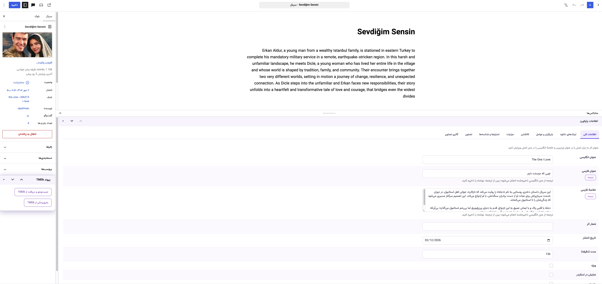](./admin-series-editor.jpg)

### ویرایش هنرمند

[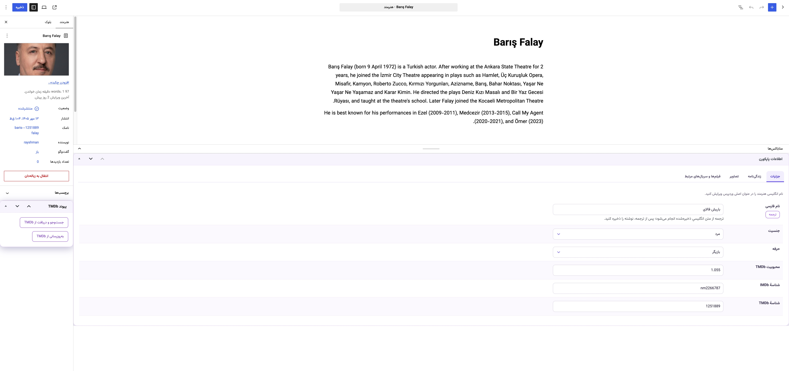](./admin-artist-editor.jpg)
